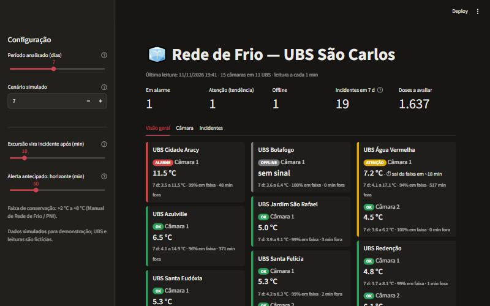
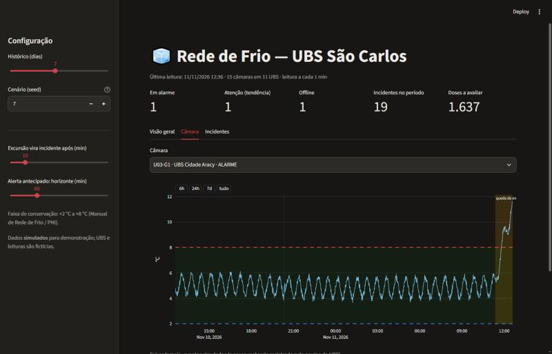

# Rede de Frio: monitoramento de vacinas nas UBS de São Carlos

Este é um painel que acompanha a temperatura das câmaras de vacina das UBS e avisa antes que o problema vire perda. O foco é o tempo de reação. Hoje, o controle manual (leitura cerca de 3 vezes ao dia) só descobre uma excursão horas depois. O painel mostra em minutos e, quando a temperatura vem subindo, **antes** de sair da faixa.

**▶ Demo online:** https://vaccine-cold-chain-monitor.streamlit.app/



## O problema

- **Perdas no país:** o TCU estimou cerca de 28 milhões de doses perdidas em 2021–2022, um prejuízo de R$ 1,2 bilhão.
- **Peso das falhas de conservação:** num estudo regional em SP, 41% das doses expostas a alteração de temperatura foram perdidas, e 70% das falhas tinham causa estrutural (energia, equipamento).

As fontes estão no trabalho original da disciplina, citado no fim deste README.

## O que o painel faz

| Função | Como |
|---|---|
| **Status por câmara** | OK, **ATENÇÃO**, **ALARME** (fora de +2 a +8 °C) ou **OFFLINE** (sem leitura há 10 min), ordenados do mais grave ao menos grave |
| **Alerta antecipado** | Tendência linear sobre a média móvel de 40 min (cerca de 1 ciclo do compressor, para não alarmar com a oscilação normal), com compensação do atraso da média. Avisa "sai da faixa em ~N min" |
| **Incidentes** | Excursões contínuas com duração e pico. Excursões curtas, como uma porta aberta rapidamente, ficam registradas mas só viram incidente acima da tolerância configurável |
| **Doses a avaliar** | Soma das doses em câmaras com alarme agora ou com incidente nas últimas 24 h, que precisam de avaliação técnica antes do uso |
| **Relatório** | Incidentes por UBS e exportação em CSV para a conformidade |



## Dados

Este repositório **não usa dados reais**. O `coldchain/simulator.py` gera leituras realistas de 11 UBS, determinísticas por `seed`:
- ciclo do compressor;
- ruído do sensor DS18B20;
- aquecimento da sala à tarde;
- porta aberta, queda de energia, falha de compressor e sensor sem sinal, que são mais frequentes em refrigerador doméstico.

A especificação do hardware veio do projeto original: ESP32 + DS18B20, envio a cada 30 s via MQTT. Com sensores reais, o simulador seria trocado por uma leitura do banco de séries temporais (InfluxDB), e a camada de análise continuaria a mesma.

## Rodar

```bash
pip install -r requirements.txt
streamlit run app.py
pytest            # testes das regras: incidentes, alerta antecipado, status, doses, simulador
```

## Origem

Este painel nasceu do trabalho final de **SSC0530 – Introdução a Sistemas de Informação** (ICMC/USP). O trabalho fez o levantamento do problema na rede de frio das UBS de São Carlos, a especificação técnica, a análise de custos e o protótipo de telas no Figma. Aquele trabalho parou no mockup. Este repositório implementa o painel e as regras de alerta. <!-- TODO: autores do trabalho original / link do Figma, se o colega autorizar -->
